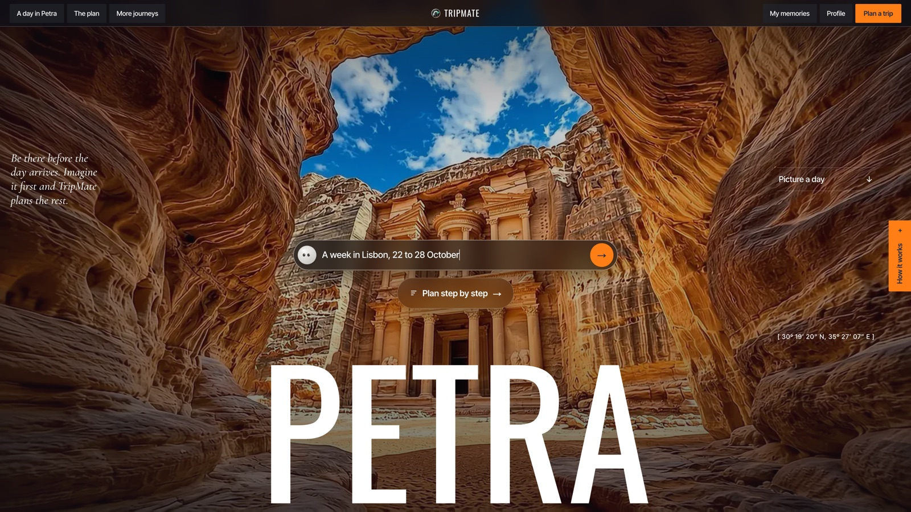
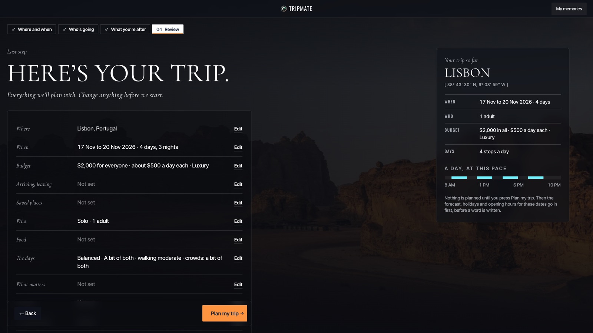
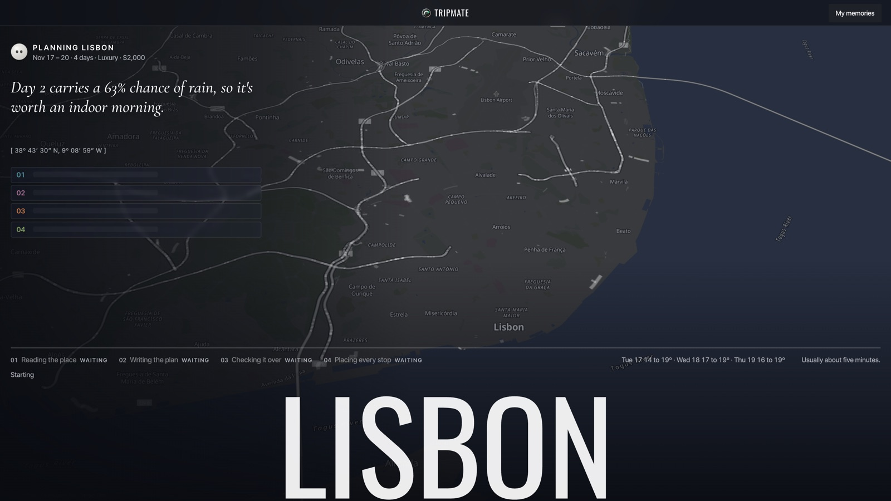
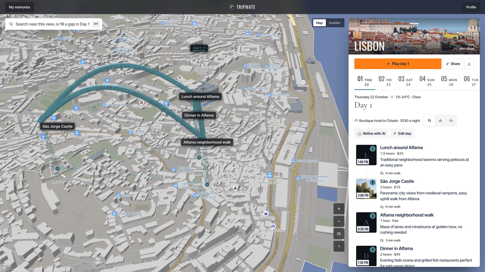
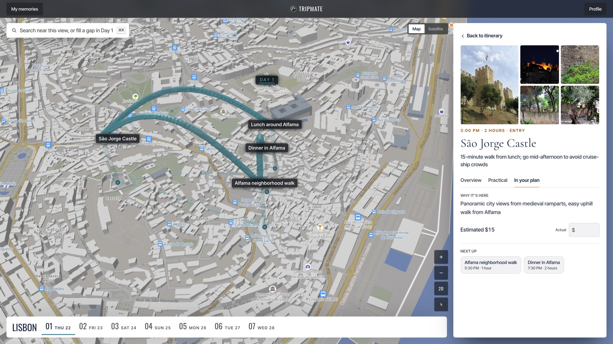
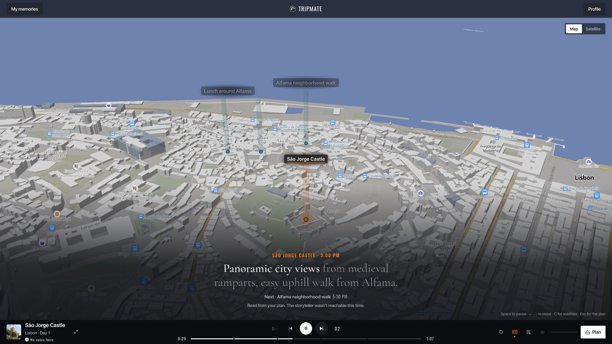
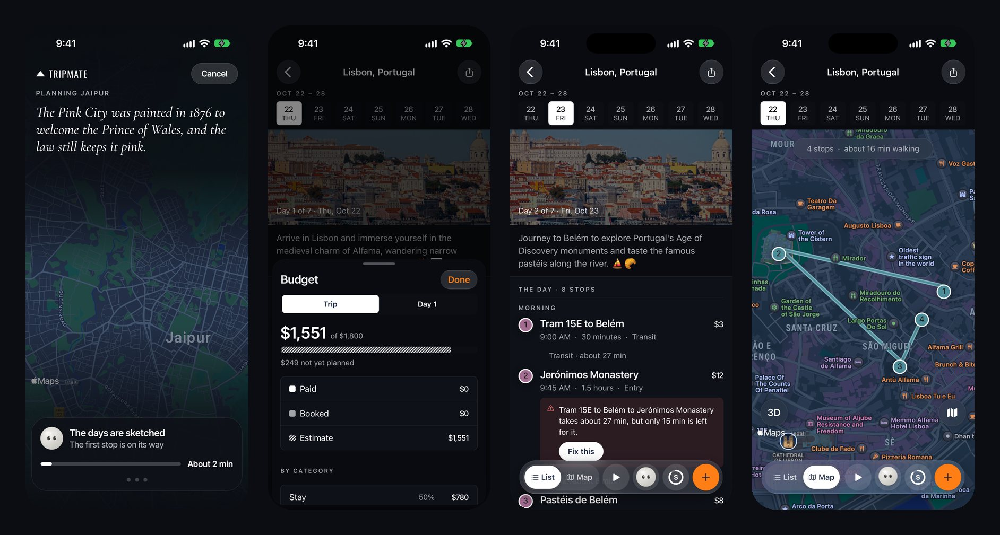
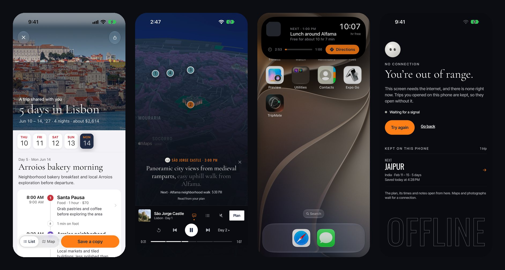
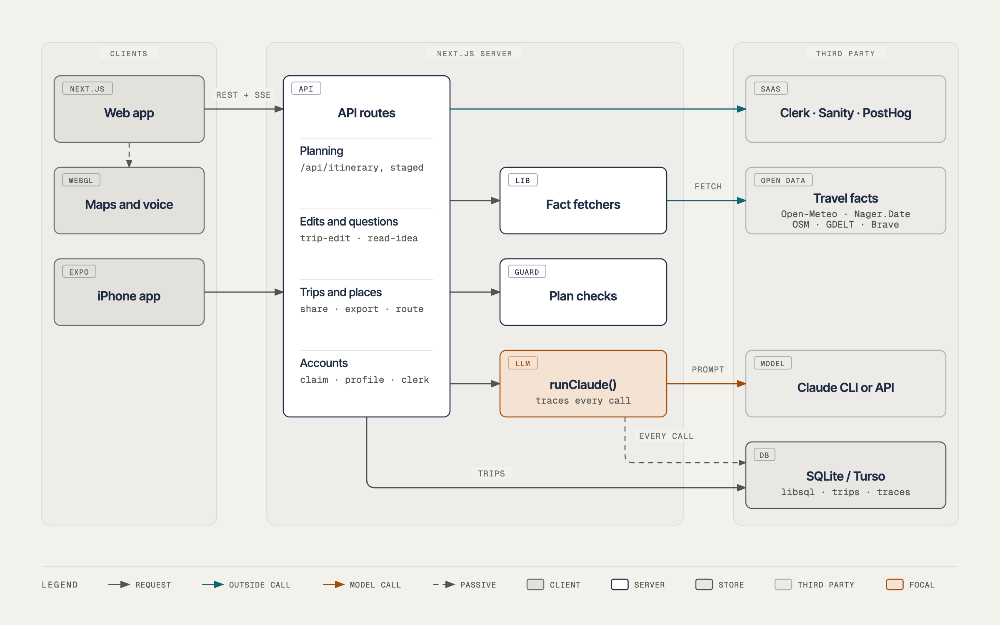

# TripMate

**Tell it where and when you're going, and it plans the actual days.**

TripMate is an AI trip planner for the web and iPhone. Instead of a list of things to see, it gives a
day-by-day plan with times, costs, walking times, and a reason each stop is there. It checks the plan
against the real forecast, opening hours and public holidays for the dates you're travelling.

[](docs/media/tripmate-showreel.mp4)

## Why it exists

Ask a chatbot for an itinerary and you get something that sounds right but doesn't know the museum is
shut on Tuesdays, that it will be 34°C at 2 pm, or that two of the stops are an hour apart in
opposite directions. TripMate's bet is that the useful part of a plan isn't the prose but the
constraints. So the model plans against data fetched for those exact dates (forecast and daylight,
public holidays, OpenStreetMap opening hours and accessibility tags, candidate places) and against a
stated traveller profile: pace, mobility, diet, who you're travelling with, and your budget.

## What it does

**Plans from one sentence.** Type "A week in Lisbon, 22 to 28 October", or go step by step through
where, who, pace and budget.



**Checks the plan while it writes it.** Before a word is written, the forecast, public holidays and
opening hours for your dates go in first, and you see the facts it is planning around as it works.

<p align="center">
  
  
</p>

**Lays the days out on a 3D map.** Each stop has a time, a duration, a cost and the walk to the next
one, and every stop opens to photos, why it's in your plan, and what comes after it.



**Story mode narrates a day.** Press Play and the camera flies to each stop while a voice reads a
short script and the subtitle lights word by word. The voice runs in the browser
([Kokoro-82M](https://huggingface.co/hexgrad/Kokoro-82M) on WebGPU), with the platform voice as a fallback.

<p align="center">
  
  
</p>

**Answers travel questions from checked facts.** Meri, the planner's assistant, answers questions like
"best time to visit Petra?" only from facts fetched for that question, with where each fact came from.
If the model names a place or source the evidence doesn't hold, the whole answer is replaced with an
honest "nothing checked".

**Lets you change the plan in plain words.** Chat edits the plan as small patches, the day board can
be reordered by hand, and conflicts (a closed day, a stop too far away) are flagged with fixes.

**Imports a plan you already have.** Paste your own itinerary and TripMate fills in costs, durations
and descriptions without adding, dropping or reordering a single stop.

**Comes with you on the iPhone.** The Expo app plans a trip while you wait, keeps the budget against
what's planned, catches a leg that doesn't fit before you're standing at the tram stop, and lets you
ask for a change in plain words.



On the trip it opens a shared plan, plays the same story mode, keeps the next stop in the Dynamic
Island as a Live Activity, and still opens your saved trips with no signal.



Saved trips also export as one self-contained HTML file that works offline, and as a printable
version numbered "Day N · Stop M" for sending to someone to review.

## Engineering highlights

- **A build check for a bug no other tool could see.** `next build` reported success for months while
  shipping a map chunk no browser could parse: the minifier re-encoded a WASM decoder embedded as a
  string, and a NUL byte followed by a digit became an illegal escape. Production rendered the whole
  app with no globe and no error. [`shims/spz-loader-core.ts`](shims/spz-loader-core.ts) fixes it, and
  [`scripts/verify-build.mjs`](scripts/verify-build.mjs) now fails the build if any emitted chunk
  won't parse.
- **Answers that can't make up places.** Places, months and sources shown to a traveller are rendered
  from the evidence records the model's ids point at, never from its prose
  ([`src/lib/meriAnswer.ts`](src/lib/meriAnswer.ts)). The check is the guarantee, not the prompt.
- **Two map engines behind one interface.** MapLibre (the default) and Cesium with Google Photorealistic
  3D Tiles both implement [`src/lib/mapRenderer.ts`](src/lib/mapRenderer.ts), in metres, degrees and
  pixels. Switching keeps the camera where it was. Day routes on MapLibre are a custom WebGL layer
  ([`src/lib/maplibreArcLayer.ts`](src/lib/maplibreArcLayer.ts)), because MapLibre has no elevated-line
  primitive.
- **Story mode measured, not guessed.** The narration beat is the clock for the camera, the voice and
  the subtitle ([`src/lib/storyMode.tsx`](src/lib/storyMode.tsx)). The neural voice shares the GPU with
  the map, so it synthesises during the camera's holds. That took a film from 45 dropped frames over
  32 ms to 7. The model runs in a Blob worker, which kept the main thread's worst stall under a second
  instead of 17.
- **One choke point for every model call.** [`runClaude()`](src/lib/claude.ts) logs a trace row on
  every outcome and serves two transports with the same contract: the `claude` CLI for free local
  development, and the Anthropic API in production, with per-task model routing in
  [`src/lib/llmConfig.ts`](src/lib/llmConfig.ts).
- **Plans survive the app being closed.** iOS suspends an app that's left mid-generation, so the server
  saves the draft the moment the plan exists, and the phone recovers a dropped stream from a run-status
  endpoint instead of starting again.
- **Failures degrade instead of throwing.** Every external fetch returns `null` for "failed" and `[]`
  for "found nothing", so the UI can tell an outage from an empty neighbourhood. Partial-failure rules
  live in one place, [`src/lib/reconcile.ts`](src/lib/reconcile.ts).

## How it fits together

<picture>
  <source media="(prefers-color-scheme: dark)" srcset="docs/media/architecture/architecture-dark.png">
  
</picture>

<sub>Editable source: <a href="docs/media/architecture/"><code>docs/media/architecture/</code></a></sub>

| Layer | Built with |
|---|---|
| Web | Next.js 16 (App Router), React 19, Tailwind CSS 4, TypeScript |
| Maps | MapLibre GL JS with OpenFreeMap tiles and terrain; CesiumJS with Google Photorealistic 3D Tiles |
| Mobile | Expo 57, React Native 0.86, Expo Router, react-native-maps, Live Activities through `expo-widgets` |
| AI | Claude, through the `claude` CLI or `@anthropic-ai/sdk`; Kokoro-82M text-to-speech in the browser |
| Data | SQLite through `libsql` (local file or Turso), Sanity for the ready-made trips |
| Accounts and analytics | Clerk; PostHog, loaded only after consent |

## Running it locally

You need Node 22 or later (`.nvmrc` pins it).

```bash
nvm use
npm install
npm run dev
```

By default model calls go through the [`claude` CLI](https://claude.com/claude-code), which must be
installed and signed in. To use the Anthropic API instead, set `LLM_TRANSPORT=api` and
`ANTHROPIC_API_KEY` in `.env.local`.

Everything else is optional and degrades softly. Weather, geocoding, public holidays and OpenStreetMap
need no key. [`.env.local.example`](.env.local.example) lists the optional keys (OpenTripMap, Brave,
Cesium ion, Sanity, Clerk, PostHog) and what each one turns on. Without Clerk keys the app runs signed
out, and an account is never required: trips made signed out move to your account when you sign in.

The iPhone app talks to the same server:

```bash
cd mobile
npm install
npx expo run:ios
```

Set `EXPO_PUBLIC_API_BASE_URL` in `mobile/.env` to reach the server from a physical device. See
[`mobile/README.md`](mobile/README.md).

## Tests and checks

| | |
|---|---|
| `npm test` | 1,876 tests over the web app's logic (Node's built-in test runner, no framework) |
| `cd mobile && npm test` | 632 Jest tests for the iPhone app |
| `npx tsc --noEmit -p tsconfig.json` and `npm run lint` | Typecheck and lint |
| `npm run build` | Builds, then fails if any emitted chunk can't be parsed |
| `npm run verify-layout` | Checks the layout at 10 viewports against a running production server |

The suites cover deterministic logic, much of it logic that has broken once. Nothing renders and no
route boots in them, so changes are also checked against a running server.

## Status

TripMate works end to end locally and in iOS simulator and device builds. It isn't deployed publicly:
generating a plan calls the Claude API, and a public demo would bill every visitor's plan.

Two paid integrations are written and tested but switched off on purpose: Yelp (verified restaurants
for a dietary need) and Google Places (the map's search box). Without them, search runs on the free
OpenStreetMap Overpass service, and restaurant names in a stop's notes come from the model rather than
a lookup.
## Docs

[`DECISIONS.md`](DECISIONS.md) records the calls that shaped TripMate, why each was made and what it
cost. [`CLAUDE.md`](CLAUDE.md) holds the architecture notes and the gotchas worth reading before
changing anything. [`docs/`](docs/) holds the measurements behind it: the cost of each map engine,
a 29-criterion audit of plan quality, and model speed and cost.

## Credits

Built by [Zaid Shaikh](https://github.com/DiazSk) and [Aryan Singh](https://github.com/iamaryansingh).

Copyright © 2026 Zaid Shaikh and Aryan Singh. All rights reserved. The source is public to read; no
license is granted to copy, modify or redistribute it.
